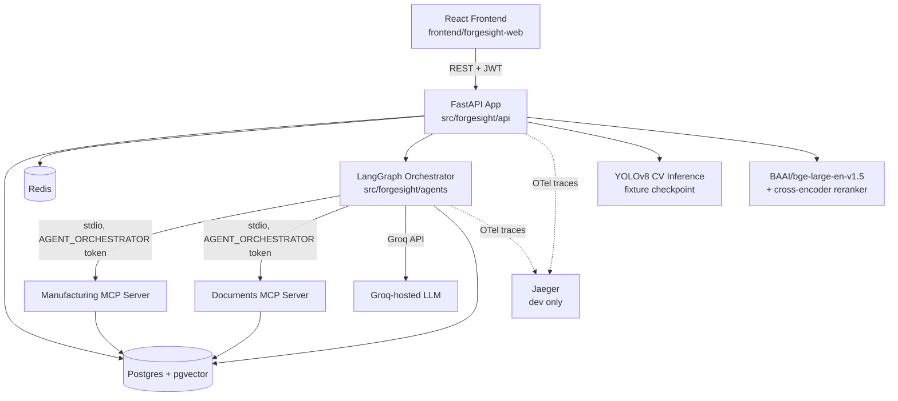

# ForgeSight AI — System Overview

A single-page index across all 13 phases, and the real running architecture.

## Phase Index

| Phase | What it built                                                    | Key docs                                                     |
| ----- | ---------------------------------------------------------------- | ------------------------------------------------------------ |
| 1     | 12-stage workflow, 7 personas, RBAC matrix, HITL principles      | `docs/business/`                                             |
| 2     | Domain model, conceptual schema, `vector(1024)` design           | `docs/architecture/domain-model.md`                          |
| 4     | RAG chunking/embedding/retrieval design, ADR-005                 | `docs/architecture/rag-architecture.md`                      |
| 5     | MCP tool contracts, RBAC scoping, ADR-003                        | `docs/architecture/mcp-architecture.md`                      |
| 6     | Agent topology, A2A message schema, ADR-002                      | `docs/architecture/agent-topology.md`, `a2a-architecture.md` |
| 7     | FastAPI backend, domain models, RBAC, audit trail                | `src/forgesight/`                                            |
| 8     | RAG implementation (chunking, embeddings, retrieval, evaluation) | `src/forgesight/rag/`                                        |
| 9     | CV pipeline, synthetic dataset/checkpoint, evidence generation   | `src/forgesight/vision/`, `notebooks/`                       |
| 10    | Manufacturing + Documents MCP servers                            | `mcp_servers/`                                               |
| 11    | LangGraph orchestrator, 10 agents, tracing/observability         | `src/forgesight/agents/`, `src/forgesight/observability/`    |
| 12    | React investigation workspace UI                                 | `frontend/forgesight-web/`                                   |
| 13    | E2E testing, CI/CD, production deployment                        | `tests/e2e/`, `.github/workflows/`, `docs/deployment/`       |

## Real Running Architecture

## Model Provenance (read before trusting any CV output)

The CV checkpoint currently in use is a **synthetic fixture model**,
disclosed on every `CvFinding` via `dataset_used_for_training`. It has no
real-world defect detection accuracy — see `notebooks/finetune_yolov8_forgesight.ipynb`
and `data/vision/synthetic_dataset/README.md`. Do not use this system's CV
output for real manufacturing decisions until that checkpoint is replaced
with one trained on a real, labeled defect dataset, with
`config/vision/vision.yaml`'s `dataset_used_for_training` updated to match.

## Running Everything

- **Local development**: `docker compose up -d db redis`, run the app
  natively — see the root `README.md`/`.env.example`.
- **Full local stack in Docker**: `docker compose --profile full up -d`.
- **Production**: see `docs/deployment/production-deployment.md`.
- **E2E tests**: see `tests/e2e/conftest.py` — requires a real CV checkpoint
  produced manually via the notebook; never run automatically in CI.
